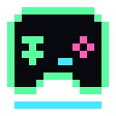

<div align="center">



# Taskbar Games

**작업표시줄 위, 작은 오락실.**

과녁을 맞히고, 홈런을 날리고, 다람쥐와 잠깐 쉬어 가세요.

`Windows` · `Pixel Art` · `Black & Neon`

[시작하기](#시작하기) · [게임 소개](#게임-소개) · [개발하기](#개발하기)

</div>

---

## 시작하기

1. 빌드된 **`bin\Taskbar_Games.exe`**를 실행합니다.
2. 작업표시줄 오른쪽 위의 선택창에서 게임을 고릅니다.
3. 게임에서 **`Esc`**를 누르면 선택창으로 돌아옵니다.

Windows 기본 .NET Framework를 사용하며 별도 패키지는 필요하지 않습니다. 실행 파일이 없다면 아래의 [빌드 방법](#개발하기)을 참고하세요.

| 선택창 | 왼쪽 | 오른쪽 |
| :--- | :---: | :---: |
| 위쪽 | 포트리스 | 야구 |
| 아래쪽 | 다람쥐 | 공룡 러너 |

선택창은 **58×74픽셀**입니다. 게임 4개를 2×2로 배치하고 아래에 작은 **EXIT** 버튼을 두었습니다. 아이콘에 마우스를 올리면 이름과 조작 안내가 나타납니다. 게임은 한 번에 하나씩 실행됩니다.

> **프로그램 종료** — 선택창에서 `Esc` 또는 **EXIT**를 누르세요.

## 게임 소개

### 🎯 Fortress · 한 발의 거리 감각

스페이스바를 누른 시간만큼 힘을 모아 과녁을 맞히세요. 명중하면 과녁이 픽셀 조각으로 터지고, 연속 명중에는 콤보가 붙습니다.

| 조작 | 동작 |
| :--- | :--- |
| 탱크·점수판 클릭 | 게임 조작 시작 |
| `Space` 누르기 → 떼기 | 힘 충전 → 발사 |
| 탱크 우클릭 | 12색 팔레트에서 색상 선택 |
| `Esc` / 점수판 **×** | 게임 선택으로 돌아가기 |

최대 충전은 **2초**. 빗나가도 같은 과녁에 다시 도전할 수 있습니다. 다른 앱으로 전환하면 충전이 취소됩니다.

### ⚾ Baseball · 타이밍 하나로 홈런까지

투수가 던지는 공에 맞춰 스윙하세요. 정확하게 맞힐수록 멀리 날아가고, 130m 펜스를 넘으면 홈런입니다.

| 조작 | 동작 |
| :--- | :--- |
| 타자·점수판 클릭 | 투구 시작 |
| `Space` 한 번 | 스윙 — 한 투구에 한 번 |
| `Esc` / 점수판 **×** | 게임 선택으로 돌아가기 |

**`PERFECT` → `GOOD` → `HIT`** 순으로 타격 정확도를 표시합니다. 비거리는 **12~160m**, 점수는 **1m당 10점**이며 공이 착지한 뒤 결과를 보여줍니다.

다른 앱으로 전환하면 진행 중인 투구는 취소됩니다. 이미 친 공의 비행과 결과 화면은 잠시 멈췄다가 돌아오면 이어집니다.

### 🐿️ Squirrel · 곁에 두는 작은 친구

작업표시줄을 천천히 산책하고, 쉬고, 낮잠을 자는 픽셀 다람쥐입니다. 도토리를 놓아 주거나 쓰다듬어 주세요.

| 조작 | 동작 |
| :--- | :--- |
| 다람쥐 클릭 | 쓰다듬기 |
| 다람쥐 우클릭 | 작은 아이콘 메뉴 열기 |
| 도토리 아이콘 → 원하는 위치 클릭 | 먹이 추가 · 가까운 것부터 찾아가 먹기 |
| 배치 중 `Esc` / 우클릭 | 도토리 배치 취소 |
| `Esc` / 메뉴의 **게임 선택으로 돌아가기** | 게임 선택으로 돌아가기 |

| 산책 | 쉬기 | 낮잠 |
| :---: | :---: | :---: |
| 2~4분 | 1~3분 | 3~5분 |

우클릭 메뉴는 **상태 · 도토리 · 쓰다듬기 · 낮잠 · 돌아가기** 아이콘 5개로 구성됩니다. 마우스를 올리면 설명이 나타나고, 상태 아이콘에서는 포만감·기분·먹은 횟수를 확인할 수 있습니다.

다른 앱을 사용해도 산책은 이어집니다. 도토리는 바닥에 최대 5개까지 놓을 수 있으며 기존 도토리는 사라지지 않습니다. 5개가 있으면 먹이 아이콘이 잠시 비활성화됩니다. 다람쥐는 가까운 것부터 찾아가 먹습니다. 먹는 도중 추가한 도토리는 현재 먹기를 마친 뒤 찾아갑니다. 먹으러 가는 중에도 쓰다듬거나 재울 수 있으며, 해당 행동이 끝나면 다시 가까운 먹이를 찾습니다. 배치 중에는 화면을 어둡게 덮지 않고 작은 도토리 미리보기만 표시합니다.

**부담 없이 돌보세요.** 방치해도 아프거나 떠나지 않으며, 프로그램을 꺼 둔 동안에는 상태가 줄어들지 않습니다. 포만감·기분·먹은 도토리 수는 자동으로 저장됩니다.

### 🦖 Dino Runner · 선인장을 넘어 달리기

작은 픽셀 공룡이 **화면 왼쪽 절반**의 작업표시줄 위를 달립니다. 공룡·선인장·점수판은 눈에 덜 띄는 **흑백 테마**입니다. 장애물 간격은 무작위로 달라지며, 최고 속도에서도 착지 후 다시 점프할 여유를 확보합니다. 달리는 속도는 초당 140픽셀에서 180초에 걸쳐 최대 4배인 560픽셀까지 증가합니다.

| 조작 | 동작 |
| :--- | :--- |
| 공룡·점수판 클릭 | 게임에 포커스 주기 |
| `Space` | 시작·점프 |
| `Space` 짧게 / 길게 누르기 | 낮은 점프 / 높은 점프 |
| 충돌 후 `Space` | 다시 시작 |
| `Esc` / 점수판 **X** | 게임 선택으로 돌아가기 |

다른 앱으로 전환하면 일시 정지됩니다. **HI**는 현재 게임 창을 열어 둔 동안의 최고 점수이며, 재시작해도 유지됩니다. 게임 선택창으로 돌아가면 초기화됩니다.

## 사용 환경

| 항목 | 지원 내용 |
| :--- | :--- |
| 운영체제 | Windows · .NET Framework |
| 표시 위치 | 기본 모니터의 작업 영역 아래쪽 |
| 작업표시줄 | 아래쪽 배치 기준으로 설계 |
| 자동 숨김·세로 배치 | 작업 영역 아래쪽에 표시 |
| 창 표시 | 일반 창 위에 유지 · 전체 화면 전용 앱에서는 표시를 보장하지 않음 |
| 입력 | 게임에 포커스가 있을 때만 키보드 입력 처리 |

스페이스바를 누른 채 다른 앱에서 돌아왔다면, 키를 한 번 떼고 다시 눌러 주세요.

## 개발하기

프로젝트 루트에서 Windows PowerShell로 실행합니다.

```powershell
# 빌드 → bin\Taskbar_Games.exe
powershell -NoProfile -ExecutionPolicy Bypass -File .\scripts\build.ps1

# 빌드 및 전체 테스트
powershell -NoProfile -ExecutionPolicy Bypass -File .\scripts\test.ps1
```

실행 중인 게임을 종료한 뒤 빌드하세요. 테스트 화면은 `artifacts/tests/`에 생성됩니다.

```text
Taskbar_Games/
├─ assets/          # 앱 아이콘
├─ src/
│  ├─ Launcher/     # 2×2 게임 선택창
│  ├─ Shared/       # 픽셀 글꼴 · 테마 · 색상 팔레트
│  └─ Games/        # Fortress · Baseball · Pet · Runner
├─ tests/           # 게임별 회귀 테스트
├─ scripts/         # 빌드 · 테스트 · 아이콘 생성
└─ docs/            # 상세 동작과 구현 참고
```

수치별 규칙, 설정 저장 위치, 갱신 방식은 **[상세 동작 및 개발 참고](docs/DETAILS.md)**에서 확인할 수 있습니다.

현재는 네 게임의 기본 플레이를 제공합니다. 도전 모드, 다람쥐 미니퀘스트·모션 해금, 여러 게임의 동시 실행은 아직 포함하지 않습니다.
